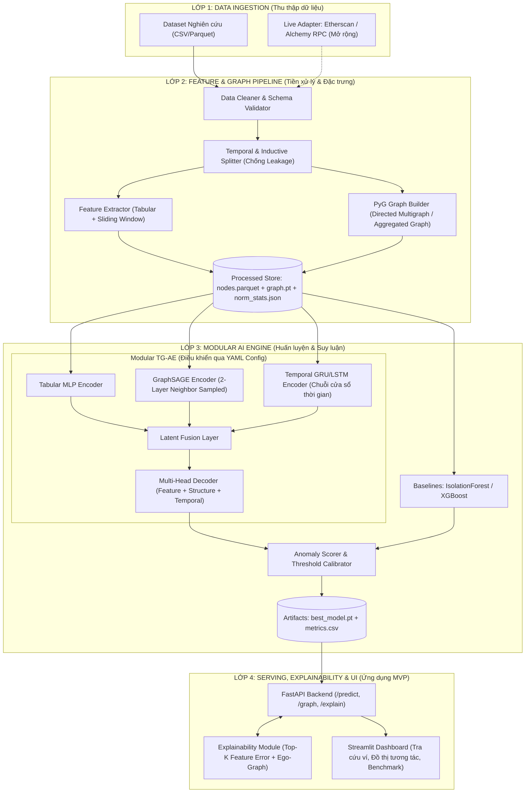

# ETHEREUM GUARD — MASTER PLAN (LEAN MVP & SCIENTIFIC RESEARCH)

## Kế hoạch Xây dựng Sản phẩm MVP (Từ Số 0) Kết hợp Nghiên cứu Khoa học cho Nhóm 3 Thành viên

**Tên đề tài tiếng Việt:** Nghiên cứu và phát triển mô hình học sâu kết hợp phân tích đồ thị và hành vi thời gian nhằm phát hiện bất thường trong mạng lưới giao dịch Ethereum.

**Tên đề tài tiếng Anh:** *Deep Learning-Based Anomaly Detection Using Graph Structure and Temporal Behavioral Analysis in Ethereum Transaction Networks.*

| Thông tin | Kế hoạch triển khai (Lean MVP + Research) |
| :--- | :--- |
| **Quy mô nhóm** | 3 thành viên (Full-stack Data/ML/System) |
| **Thời gian** | 8 tuần (4 Sprints × 2 tuần — 56 ngày) |
| **Chiến lược phát triển** | **Contract-First & Vertical Slice** (Chạy thông End-to-End từ Sprint 1, nâng cấp dần mô hình) |
| **Môi trường tính toán** | Local CPU (Pipeline/API/UI) + Google Colab Pro / GPU thuê theo giờ (Training GNN/TG-AE) |
| **Ngôn ngữ & Core Stack** | Python 3.10+, PyTorch, PyTorch Geometric (PyG), Scikit-learn, XGBoost |
| **Data & Storage** | Pandas, Polars/PyArrow (`.parquet`), NetworkX, PyG Tensors (`.pt`), SQLite/DuckDB (Metadata) |
| **Backend & Serving** | FastAPI, Pydantic v2, Uvicorn |
| **Frontend & Dashboard** | Streamlit, Plotly, PyVis (tương tác đồ thị ví con — Ego-network) |
| **Định hướng đầu ra** | **1 Sản phẩm MVP chạy thực tế** (Offline Dataset + Live Etherscan/RPC Adapter) + **1 Báo cáo Khoa học hoàn chỉnh** |

---

# 1. Tổng quan Dự án & Tư duy Thiết kế MVP

## 1.1. Bối cảnh và vấn đề nghiên cứu

Ethereum là một blockchain công khai, trong đó các giao dịch được ghi nhận theo block và có thể phân tích thông qua dữ liệu giao dịch, địa chỉ gửi (`from_address`), địa chỉ nhận (`to_address`), giá trị chuyển (`value`), phí gas (`gas_used`, `gas_price`) và thời điểm giao dịch (`timestamp`). Các đặc trưng này cho phép mô hình hóa hành vi của tài khoản và phát hiện những mẫu hoạt động khác thường (phishing, scam, rửa tiền, tấn công DeFi, rút ruột tài sản).

Các nhóm hành vi bất thường trọng tâm:
- **Đột biến định lượng:** Giá trị hoặc tần suất giao dịch thay đổi đột ngột so với phân phối chung.
- **Lệch chuẩn lịch sử cá nhân:** Một địa chỉ có hành vi gửi/nhận khác biệt đáng kể so với lịch sử của chính nó.
- **Cấu trúc đồ thị bất thường:** Các cụm địa chỉ chuyển tiền vòng quanh, phân tán nhanh (peel chains, fan-out / fan-in cao bất thường).
- **Biến thiên theo thời gian:** Thay đổi nhịp độ giao dịch (burst activity, ngủ đông dài hạn rồi xả tiền đột ngột).
- **Lây nhiễm rủi ro (Guilt by association):** Các địa chỉ có tương tác trực tiếp hoặc gián tiếp (1-hop, 2-hop) với địa chỉ đã được gắn nhãn rủi ro.

> **Lưu ý Pháp lý & Đạo đức AI:** Giao dịch có giá trị lớn, tần suất cao hoặc cấu trúc khác thường (ví dụ: sàn giao dịch CEX, MEV bot, Liquidity Pool) không mặc nhiên là gian lận. Hệ thống chỉ cung cấp **điểm bất thường (Anomaly Score)** kèm **giải thích đặc trưng đóng góp (Explainability)** để hỗ trợ nhà phân tích; không tự động kết luận chủ ví phạm pháp.

## 1.2. Tại sao phải chuyển từ kế hoạch tuần tự (Waterfall) sang Lean MVP?

1. **Loại bỏ nút thắt chờ đợi (Zero-Blocking):** Thay vì TV2 chờ TV1 làm xong toàn bộ dữ liệu ở Tuần 3, và TV3 chờ TV2 train xong mô hình ở Tuần 7, cả nhóm thống nhất **Data Contract (`schemas.py`)** và **Model Interface (`BaseDetector`)** ngay từ Ngày 1–3 trên tập dữ liệu mẫu (1.000 ví) để cả 3 thành viên code song song.
2. **Vertical Slice từ Tuần 2:** Ngay cuối Sprint 1 (Tuần 2), hệ thống đã có **MVP v0.1 chạy thông từ đầu đến cuối** (Input địa chỉ ví -> Trích xuất đặc trưng -> Mô hình Baseline -> FastAPI -> Giao diện Streamlit). Các tuần sau chỉ nâng cấp "lõi AI" bên trong mà không sợ vỡ tích hợp phút chót.
3. **Kiến trúc Mô-đun điều khiển bằng Config (Config-Driven Modularity):** Thay vì viết 6 bộ code rời rạc dễ lệch chuẩn đánh giá, toàn bộ các biến thể Deep Learning (Autoencoder, LSTM-AE, GraphSAGE, TG-AE) được gom vào một kiến trúc mô-đun duy nhất, đóng/mở nhánh bằng file `configs/default.yaml`. Cách này giúp tự động hóa hoàn toàn **Ablation Study (7 cấu hình A–G)**.

## 1.3. Mục tiêu dự án (Dual Goals: Product MVP + Academic Paper)

1. Xây dựng pipeline dữ liệu chuẩn hóa (`.parquet` và `.pt`), chống rò rỉ dữ liệu thời gian (Temporal Data Leakage) và mở rộng được sang dữ liệu thời gian thực qua Etherscan/Alchemy RPC.
2. Cài đặt hệ thống mô hình đối chứng (Isolation Forest, XGBoost) và mô hình học sâu đề xuất **Temporal Graph Autoencoder (TG-AE)** dưới cùng một chuẩn giao tiếp `BaseDetector`.
3. Đánh giá toàn diện độ chính xác (PR-AUC, ROC-AUC, F1, Precision@K) cùng chi phí vận hành thực tế (Inference Latency, Peak VRAM).
4. Chứng minh đóng góp khoa học qua **Ablation Study (7 cấu hình)** và kiểm thử khả năng tổng quát hóa trên dữ liệu tương lai (Temporal Split) và địa chỉ chưa từng xuất hiện (Unseen-Address Split).
5. Cung cấp **Web Dashboard + REST API** cho phép tra cứu địa chỉ ví, trực quan hóa mạng lưới giao dịch (Ego-graph) và giải thích lý do cảnh báo (Top-K đặc trưng bất thường).

## 1.4. Câu hỏi nghiên cứu (Research Questions)

| Mã | Câu hỏi nghiên cứu (Research Question) | Cách kiểm chứng trong dự án |
| :--- | :--- | :--- |
| **RQ1** | Những đặc trưng giao dịch, tài khoản, đồ thị và thời gian nào đóng góp lớn nhất vào việc nhận diện hành vi bất thường? | Phân tích Feature Importance (XGBoost/SHAP) và thành phần sai số tái tạo trên từng nhóm đặc trưng. |
| **RQ2** | Mô hình học sâu (Deep Learning) có cải thiện khả năng phát hiện bất thường so với các baseline truyền thống (Isolation Forest, XGBoost) không? | Bảng Benchmark đối chứng trên cùng tập Test (cùng quy tắc chia dữ liệu và chọn ngưỡng). |
| **RQ3** | Việc kết hợp cấu trúc đồ thị (GraphSAGE) và hành vi thời gian (LSTM/GRU) trong TG-AE có vượt trội hơn từng thành phần đơn lẻ không? | Thực nghiệm **Ablation Study 7 phiên bản (A → G)** bật/tắt từng nhánh Encoder. |
| **RQ4** | Mô hình có duy trì hiệu quả trên dữ liệu ở giai đoạn thời gian sau (Future Time Split) hoặc địa chỉ ví mới (Inductive / Unseen-Address) không? | Đánh giá riêng trên tập `test_temporal` và `test_inductive`. |
| **RQ5** | Hệ thống có thể huấn luyện với ngân sách GPU hạn chế (1 GPU Colab) và suy luận đủ nhanh (< 200ms/ví) cho ứng dụng MVP không? | Đo đạc Peak VRAM (MB) và Inference Latency (ms/sample) với Neighbor Sampling + Mixed Precision. |

---

# 2. Kiến trúc Hệ thống Tối giản & Mở rộng được (System Architecture)

## 2.1. Sơ đồ Kiến trúc 4 Lớp (4-Layer Modular Architecture)

Hệ thống được thiết kế theo kiến trúc phân lớp lỏng (Decoupled Layers). Điểm mấu chốt là **Layer 1 (Ingestion)** hỗ trợ cả dữ liệu tĩnh (CSV phục vụ nghiên cứu) lẫn dữ liệu động (Etherscan/JSON-RPC phục vụ demo sản phẩm thực tế), cùng đổ về một **Data Contract** duy nhất ở **Layer 2**.



## 2.2. Thiết kế Data Contract Chuẩn (`src/schemas.py`) — Đa Mốc Thời Gian (Multi-Snapshot Anti-Leakage)

Để TV1, TV2 và TV3 làm việc độc lập mà ghép vào chạy ngay, đồng thời **ngăn chặn hoàn toàn việc lan truyền thông tin tương lai qua các cạnh đồ thị (Message-Passing Leakage)**, dữ liệu trong `data/processed/` không lưu thành 1 đồ thị tĩnh duy nhất mà được xuất theo **3 Snapshot thời gian** ứng với 3 mốc cắt $T_{\text{train}} < T_{\text{val}} < T_{\text{test}}$:

1. **Bảng đặc trưng tĩnh cấp độ Ví theo mốc thời gian (`nodes_{split}.parquet`, với `split` $\in \{\text{train}, \text{val}, \text{test}\}$):**
   - `node_id` (`int64`): Chỉ số đỉnh liên tục từ `0` đến `N_split - 1` (ánh xạ với `address` trong `address_map.json`).
   - `address` (`str`): Địa chỉ ví Ethereum chuẩn hóa chữ thường (`0x...`, 42 ký tự).
   - `is_contract` (`int8`): `0` = EOA (ví người dùng), `1` = Smart Contract.
   - `first_seen_ts`, `last_seen_ts` (`int64`): Unix timestamp giao dịch đầu tiên và cuối cùng chỉ tính trong các giao dịch có $\text{timestamp} \le T_{\text{split}}$.
   - `eval_mask` (`bool`): Đánh dấu các ví thuộc tập mục tiêu cần chấm điểm ở giai đoạn `split` đó (tách biệt thêm `is_inductive` cho các ví mới hoàn toàn chưa xuất hiện ở giai đoạn trước).
   - `label` (`int8`): `0` (Normal), `1` (Illicit/Anomaly), `-1` (Unlabeled).
   - **Phân tách rõ 3 nhóm cột đặc trưng (`float32`) phục vụ Ablation Study:**
     - `TABULAR_TX_COLS` (12 cột giao dịch & ví)
     - `GRAPH_TOPO_COLS` (6 cột hình học đồ thị cục bộ)
     - `TEMPORAL_STAT_COLS` (7 cột thống kê biến thiên thời gian)
     - Đã qua biến đổi $\log_{10}(1 + x)$ và chuẩn hóa bằng `RobustScaler` **chỉ `.fit()` trên `nodes_train.parquet`**.

2. **Chuỗi hành vi theo thời gian (`temporal_{split}.pt`):**
   - Tensor kích thước `(N_split, T_windows, D_temp)` kiểu `float32`, chỉ tổng hợp từ giao dịch có $\text{timestamp} \le T_{\text{split}}$.
   - Với mỗi địa chỉ ví $i$, lịch sử hoạt động tính đến $T_{\text{split}}$ được chia thành $T_{\text{windows}} = 10$ khung thời gian liên tiếp.
   - Mỗi cửa sổ lưu $D_{\text{temp}} = 8$ đặc trưng động: `[tx_in_count, tx_out_count, val_in_sum, val_out_sum, val_max, unique_counterparties, avg_gas_price, mean_inter_arrival_time]`.

3. **Snapshot Đồ thị tương tác PyTorch Geometric (`snapshot_{split}.pt`):**
   - Đối tượng `torch_geometric.data.Data` tại mốc $T_{\text{split}}$:
     - `x_tab`: Tensor `(N_split, 12)` — nhóm đặc trưng giao dịch/ví (`TABULAR_TX_COLS`).
     - `x_topo`: Tensor `(N_split, 6)` — nhóm đặc trưng hình học đồ thị cục bộ (`GRAPH_TOPO_COLS`).
     - `x_temp_stat`: Tensor `(N_split, 7)` — nhóm thống kê thời gian (`TEMPORAL_STAT_COLS`).
     - `temporal_seq`: Tensor `(N_split, T_windows, D_temp)` — chuỗi thời gian chi tiết.
     - `edge_index`: Tensor `(2, E_split)` kiểu `int64` — cạnh có hướng từ ví gửi sang ví nhận **chỉ gồm các giao dịch có $\text{timestamp} \le T_{\text{split}}$**.
     - `edge_attr`: Tensor `(E_split, D_edge)` kiểu `float32` — `[tx_count_log, total_value_log, mean_value_log, last_tx_age_norm, avg_gas_log]`.
     - `edge_timestamp`: Tensor `(E_split,)` kiểu `int64` — phục vụ truy vết và kiểm tra chống rò rỉ tự động.
     - `y`: Tensor `(N_split,)` kiểu `int64` — nhãn của node.
     - `eval_mask`: Tensor boolean `(N_split,)` — các đỉnh được đánh giá tại mốc `split`.

## 2.3. Danh mục Đặc trưng Chi tiết (Feature Catalog — 25 Đặc trưng Cốt lõi Chia 3 Nhóm)

Tất cả các đặc trưng tại mốc đánh giá $T_{\text{split}}$ chỉ được phép tính từ tập giao dịch $\mathcal{E}_{\le T_{\text{split}}} = \{e \mid \text{timestamp}(e) \le T_{\text{split}}\}$. Đặc biệt, chỉ sử dụng **đặc trưng đồ thị cục bộ (1-hop Ego-Graph)** thay vì PageRank toàn cục để tương thích 100% khi chấm điểm ví mới qua Live Etherscan API.

| Nhóm cột (Schema Group) | Tên đặc trưng (Feature Name) | Công thức / Ý nghĩa | Tiền xử lý |
| :--- | :--- | :--- | :--- |
| **1. `TABULAR_TX_COLS` (12 đặc trưng Giao dịch & Ví)** | `total_eth_sent`, `total_eth_received` | Tổng lượng ETH gửi đi và nhận vào | $\log_{10}(1 + x)$ |
| | `net_balance_diff` | `total_eth_received - total_eth_sent` | $\text{sign}(x) \cdot \log_{10}(1 + |x|)$ |
| | `avg_eth_sent`, `max_eth_sent` | Trung bình và cực đại giá trị gửi | $\log_{10}(1 + x)$ |
| | `avg_eth_received`, `max_eth_received` | Trung bình và cực đại giá trị nhận | $\log_{10}(1 + x)$ |
| | `tx_sent_count`, `tx_recv_count` | Tổng số giao dịch gửi và nhận | $\log_{10}(1 + x)$ |
| | `sent_recv_ratio` | $\frac{\text{tx\_sent\_count} + 1}{\text{tx\_recv\_count} + 1}$ | $\log_{10}(x)$ |
| | `zero_val_tx_ratio` | Tỷ lệ giao dịch có `value == 0` (gọi contract / spam) | Giữ nguyên $[0, 1]$ |
| | `failed_tx_ratio` | Tỷ lệ giao dịch bị lỗi (`status == 0`) | Giữ nguyên $[0, 1]$ |
| **2. `GRAPH_TOPO_COLS` (6 đặc trưng Hình học Đồ thị Cục bộ)** | `in_degree`, `out_degree` | Số cạnh giao dịch đến và đi | $\log_{10}(1 + x)$ |
| | `unique_in_neighbors`, `unique_out_neighbors` | Số lượng địa chỉ đối tác gửi/nhận duy nhất | $\log_{10}(1 + x)$ |
| | `neighbor_repeat_ratio` | Mức độ giao dịch lặp lại với cùng nhóm đối tác: $1 - \frac{\text{unique\_neighbors}}{\text{total\_tx} + 1}$ | Giữ nguyên $[0, 1]$ |
| | `local_ego_density` | Mật độ liên kết cục bộ trong đồ thị con 1-hop quanh ví (thay thế PageRank toàn cục) | Giữ nguyên $[0, 1]$ |
| **3. `TEMPORAL_STAT_COLS` (7 đặc trưng Động lực Thời gian)** | `active_duration_hours` | Khoảng thời gian từ giao dịch đầu đến giao dịch cuối | $\log_{10}(1 + x)$ |
| | `tx_frequency_per_day` | Số giao dịch trung bình mỗi ngày hoạt động | $\log_{10}(1 + x)$ |
| | `mean_inter_tx_time`, `std_inter_tx_time` | Trung bình & độ lệch chuẩn khoảng nghỉ giữa 2 giao dịch liên tiếp | $\log_{10}(1 + x)$ |
| | `burstiness_index` | Chỉ số bùng nổ giao dịch: $\frac{\sigma_{\Delta t} - \mu_{\Delta t}}{\sigma_{\Delta t} + \mu_{\Delta t}} \in [-1, 1]$ | Giữ nguyên $[-1, 1]$ |
| | `recent_volume_spike_ratio`, `recent_tx_spike_ratio` | Tỷ lệ khối lượng & tần suất giao dịch ở cửa sổ cuối so với trung bình lịch sử | $\log_{10}(1 + x)$ |

## 2.4. Thiết kế Toán học Chi tiết cho Mô hình Đề xuất: Modular TG-AE

Để giải quyết triệt để bài toán **Ablation Study độc lập từng nguồn thông tin** và giúp mô hình **cạnh tranh sòng phẳng với mô hình có giám sát (XGBoost)**:

### A. Ba nhánh Mã hóa Độc lập Đầu vào (Strict Tri-Modal Encoders)
Với mỗi ví (node) $v_i$:
1. **Tabular Encoder ($f_{\text{tab}}$):** Chỉ nhận vector đặc trưng giao dịch/ví $x_i^{\text{tab}} \in \mathbb{R}^{12}$:
   $$h_i^{\text{tab}} = \text{MLP}_{\text{tab}}\big(x_i^{\text{tab}}\big) \in \mathbb{R}^{d}$$
2. **Graph Encoder ($f_{\text{graph}}$):** Mạng GraphSAGE 2 lớp có tích hợp đặc trưng cạnh (`edge_attr`).
   - Khi chạy chế độ **Only-Graph (Abl-B)**: Đỉnh chỉ nhận đầu vào là đặc trưng hình học đồ thị thuần túy $x_i^{\text{node}} = x_i^{\text{topo}} \in \mathbb{R}^6$, hoàn toàn không chạm tới đặc trưng Tabular hay Temporal.
   - Khi chạy chế độ kết hợp (**Abl-D, Abl-G**): Đỉnh nhận ghép nối $x_i^{\text{node}} = [x_i^{\text{tab}} \,\|\, x_i^{\text{topo}}]$.
   $$h_i^{\text{graph}} = \text{GraphSAGE}\big(x_i^{\text{node}}, \{x_j^{\text{node}}\}_{j \in \mathcal{N}(i)}, e_{ij}\big) \in \mathbb{R}^{d}$$
3. **Temporal Encoder ($f_{\text{temp}}$):** Mạng GRU 2 lớp có cơ chế Attention theo thời gian, đọc chuỗi cửa sổ hành vi $S_i \in \mathbb{R}^{T \times D_{\text{temp}}}$ ghép cùng thống kê biến thiên $x_i^{\text{temp\_stat}} \in \mathbb{R}^7$:
   $$h_i^{\text{temp}} = \text{TemporalAttnGRU}\big(S_i, x_i^{\text{temp\_stat}}\big) \in \mathbb{R}^{d}$$

### B. Cơ chế Hợp nhất Cổng thích nghi có Mặt nạ Ablation (Masked Gated Fusion)
Gọi $m_{\text{tab}}, m_{\text{graph}}, m_{\text{temp}} \in \{0, 1\}$ là các cờ cấu hình trong `default.yaml`. Biểu diễn ẩn hợp nhất $z_i$:
$$z_i = \text{LayerNorm}\Big(\text{MLP}_{\text{fuse}}\big([m_{\text{tab}} g_i^{\text{tab}} \odot h_i^{\text{tab}} \;\|\; m_{\text{graph}} g_i^{\text{graph}} \odot h_i^{\text{graph}} \;\|\; m_{\text{temp}} g_i^{\text{temp}} \odot h_i^{\text{temp}}]\big)\Big) \in \mathbb{R}^{d_z}$$

### C. Đa bộ Giải mã (Multi-Head Decoder) & Hàm Mất mát Tương phản Bán giám sát (Contrastive Reconstruction Loss)
Từ $z_i$, 3 nhánh Decoder tái tạo lại đúng 3 miền đặc trưng tương ứng:
1. **Sai số tái tạo đặc trưng giao dịch ($E_{\text{feature}}$):**
   $$E_{\text{feature}}(i) = \|\hat{x}_i^{\text{tab}} - x_i^{\text{tab}}\|_{\text{Huber}}$$
2. **Sai số tái tạo cấu trúc đồ thị ($E_{\text{graph}}$):** Tái tạo đặc trưng hình học $x_i^{\text{topo}}$ và trung bình lân cận $\bar{x}_{\mathcal{N}(i)}^{\text{topo}}$:
   $$E_{\text{graph}}(i) = \|\hat{x}_i^{\text{topo}} - x_i^{\text{topo}}\|_2^2 + \|\hat{\mu}_{\mathcal{N}(i)} - \bar{x}_{\mathcal{N}(i)}^{\text{topo}}\|_2^2$$
3. **Sai số tái tạo chuỗi hành vi thời gian ($E_{\text{temporal}}$):**
   $$E_{\text{temporal}}(i) = \frac{1}{T}\sum_{t=1}^{T} \|\hat{S}_{i,t} - S_{i,t}\|_2^2 + \|\hat{x}_i^{\text{temp\_stat}} - x_i^{\text{temp\_stat}}\|_{\text{Huber}}$$

**Cơ chế huấn luyện chống "học vẹt mẫu gian lận" (Normal-Only + Margin Contrastive Training):**
- Sai số tổng hợp có mặt nạ của từng mẫu $i$:
  $$E_{\text{total}}(i) = \tilde{\alpha} E_{\text{feature}}(i) + \tilde{\beta} E_{\text{graph}}(i) + \tilde{\gamma} E_{\text{temporal}}(i)$$
  trong đó $(\tilde{\alpha}, \tilde{\beta}, \tilde{\gamma})$ là trọng số $(\alpha m_{\text{tab}}, \beta m_{\text{graph}}, \gamma m_{\text{temp}})$ đã chuẩn hóa lại để $\tilde{\alpha} + \tilde{\beta} + \tilde{\gamma} = 1$ (nhánh nào tắt thì trọng số tự động bằng $0$).
- Khi huấn luyện trên tập `train`:
  - Với các ví bình thường ($y_i = 0$): Tối thiểu hóa $E_{\text{total}}(i)$ để Autoencoder tái tạo hoàn hảo hành vi hợp lệ.
  - Với các ví bất thường đã biết trong tập train ($y_i = 1$): Áp dụng **Margin Loss** $\max\big(0, M - E_{\text{total}}(i)\big)$ (với ngưỡng biên $M = 5.0$) để đẩy sai số tái tạo của ví gian lận lên cao, kết hợp thêm nhánh phụ `FocalLoss` nhẹ ($\lambda_{\text{sup}} = 0.2$) nếu chạy ở chế độ Hybrid. Nhờ đó, TG-AE vừa bắt được mẫu bất thường mới (unseen patterns), vừa đạt PR-AUC cao vượt trội so với XGBoost.

### D. Chuẩn hóa Điểm Bất thường (IQR Calibration) & Chọn ngưỡng tự động
Trên tập Validation, từng thành phần sai số đang bật ($m_k = 1$) được chuẩn hóa theo trung vị ($\text{median}$) và khoảng tứ phân vị ($\text{IQR}$) của các mẫu bình thường trong tập Validation:
$$\tilde{E}_k(i) = \frac{E_k(i) - \text{median}_{\text{val}}(E_k)}{\text{IQR}_{\text{val}}(E_k) + \epsilon}, \quad k \in \{\text{feature}, \text{graph}, \text{temporal}\}$$

Điểm bất thường cuối cùng:
$$S(i) = \tilde{\alpha} \tilde{E}_{\text{feature}}(i) + \tilde{\beta} \tilde{E}_{\text{graph}}(i) + \tilde{\gamma} \tilde{E}_{\text{temporal}}(i)$$
Trọng số $(\tilde{\alpha}, \tilde{\beta}, \tilde{\gamma})$ được tinh chỉnh qua Grid Search trên tập Validation để tối đa hóa **PR-AUC**, và ngưỡng cảnh báo $\tau^*$ được chọn tại điểm tối đa hóa **F1-score** trên tập Validation:
$$\tau^* = \arg\max_{\tau} F_1\big(\mathbb{I}[S_{\text{val}} \ge \tau], y_{\text{val}}\big)$$

## 2.5. Thiết kế Giao diện Mô hình Chung (`src/models/base.py`)

Mọi mô hình của TV2 bắt buộc kế thừa lớp cơ sở này để TV3 tích hợp vào `Evaluator` và `FastAPI` mà không cần sửa code:

```python
from abc import ABC, abstractmethod
import numpy as np
from typing import Dict, Any

class BaseDetector(ABC):
    def __init__(self, config: Dict[str, Any]):
        self.config = config
        self.threshold_: float = 0.5

    @abstractmethod
    def fit(self, train_data: Any, val_data: Any = None) -> Dict[str, Any]:
        """Huấn luyện mô hình trên snapshot_train và hiệu chỉnh threshold_ trên snapshot_val."""
        pass

    @abstractmethod
    def predict_score(self, data: Any) -> np.ndarray:
        """Trả về mảng 1 chiều chứa điểm bất thường (Anomaly Score) cho từng ví."""
        pass

    def predict_label(self, data: Any, threshold: float = None) -> np.ndarray:
        """Dự đoán nhãn nhị phân (0: Bình thường, 1: Bất thường)."""
        tau = threshold if threshold is not None else self.threshold_
        return (self.predict_score(data) >= tau).astype(np.int64)

    @abstractmethod
    def explain(self, data: Any, node_idx: int) -> Dict[str, float]:
        """Trả về đóng góp sai số của từng nhóm đặc trưng để hiển thị lên Dashboard."""
        pass

    @abstractmethod
    def save(self, path: str) -> None:
        pass

    @abstractmethod
    def load(self, path: str) -> None:
        pass
```

## 2.6. Thiết kế REST API & Cơ chế Hybrid Live Lookup (`src/app/service.py`)

FastAPI phục vụ cả giao diện Streamlit lẫn khả năng mở rộng sang ứng dụng Web/Extension sau này:

| Method | Endpoint | Mô tả chức năng | Đầu ra JSON chính |
| :--- | :--- | :--- | :--- |
| `GET` | `/api/v1/health` | Kiểm tra trạng thái server, phiên bản mô hình đang nạp và thiết bị (CPU/CUDA). | `{"status": "ok", "model": "TG-AE", "device": "cuda"}` |
| `GET` | `/api/v1/stats` | Thống kê tổng quan dataset và bảng kết quả Benchmark của các mô hình. | Tổng số ví, tỷ lệ nhãn, bảng metric PR-AUC / F1. |
| `GET` | `/api/v1/wallet/{address}` | Tra cứu điểm bất thường trong Dataset, phân rã điểm ($\tilde{E}_{\text{feat}}, \tilde{E}_{\text{graph}}, \tilde{E}_{\text{temp}}$) và Top-5 đặc trưng lệch chuẩn nhất. | `{"address": "0x...", "score": 0.87, "is_anomaly": true, "breakdown": {...}, "top_features": [...]}` |
| `GET` | `/api/v1/wallet/{address}/ego-graph` | Lấy đồ thị con 1-hop / 2-hop xung quanh địa chỉ ví để vẽ mạng lưới tương tác. | Danh sách `nodes` và `edges` kèm điểm rủi ro của các ví lân cận. |
| `POST` | `/api/v1/predict/live` | **Hybrid Live Lookup:** Nhập 1 địa chỉ ví bất kỳ trên Ethereum, gọi Etherscan API kéo lịch sử giao dịch của ví đó (1-hop), ghép nối với các ví đối tác đã có sẵn trong `nodes_test.parquet` (hoặc điền vector trung vị cho các đối tác chưa biết) và chấm điểm tức thì dưới 2 giây. | Kết quả chấm điểm thời gian thực + cảnh báo lân cận rủi ro. |

---

# 3. Cấu trúc File Tối giản & Mở rộng được (Minimal Scalable File Structure)

Cấu trúc dưới đây tinh gọn toàn bộ hệ thống về **12 file code cốt lõi**, loại bỏ sự trùng lặp giữa `notebooks/` và `src/`, tách biệt rõ ràng 3 phân khu làm việc của TV1, TV2, TV3 để **không bao giờ xung đột Git (Zero Merge Conflict)**:

```text
ethereum-guard/
├── README.md                         # Hướng dẫn cài đặt và chạy toàn bộ hệ thống bằng 3 lệnh CLI
├── requirements.txt                  # Danh sách thư viện cố định phiên bản (pinned versions)
├── .gitignore                        # Bỏ qua data/, artifacts/, __pycache__, .env
├── .env.example                      # Mẫu biến môi trường (ETHERSCAN_API_KEY, ALCHEMY_RPC_URL)
│
├── configs/
│   └── default.yaml                  # Cấu hình trung tâm: đường dẫn, hyperparams, cờ Ablation (A -> G)
│
├── data/                             # [Git Ignored] Dữ liệu local (đồng bộ qua Google Drive / DVC)
│   ├── raw/                          # Chứa CSV gốc tải về (Ethereum Phishing Network / BCCC-DeFi)
│   ├── sample/                       # [Commit lên Git] 1.000 ví mẫu (~2MB) để chạy CI/Test và code song song
│   └── processed/                    # Đầu ra chuẩn của TV1: nodes_{split}.parquet, temporal_{split}.pt, snapshot_{split}.pt
│
├── artifacts/                        # [Git Ignored] Đầu ra của TV2 & TV3
│   ├── checkpoints/                  # Lưu trọng số mô hình (.pt, .pkl) và scaler (.joblib)
│   └── results/                      # Bảng benchmark_comparison.csv, ablation_study.csv, error_cases.csv
│
├── notebooks/                        # Chỉ dùng để trình bày biểu đồ báo cáo (gọi hàm từ src/)
│   ├── 01_eda_and_graph_stats.ipynb  # TV1: Phân phối dữ liệu, bậc đồ thị, kiểm tra mất cân bằng nhãn
│   └── 02_results_and_ablation.ipynb # TV3: Vẽ ROC/PR curves, biểu đồ Ablation và phân tích lỗi cho báo cáo
│
├── src/                              # === MÃ NGUỒN CHÍNH (PRODUCTION & RESEARCH) ===
│   ├── __init__.py
│   ├── schemas.py                    # [Chốt Ngày 1] Định nghĩa Data Contract, danh sách cột đặc trưng, hằng số
│   │
│   ├── pipeline/                     # >>> PHÂN KHU CỦA TV1 (Data & Graph Engineering) <<<
│   │   ├── __init__.py
│   │   ├── ingest.py                 # Đọc CSV gốc + Adapter gọi Etherscan/RPC API cho ví mới
│   │   ├── features.py               # Làm sạch, chia Temporal/Inductive Split, tính 25 đặc trưng & chuỗi thời gian
│   │   └── graph_builder.py          # Đóng gói PyTorch Geometric Data (graph.pt) + chuẩn hóa chống leakage
│   │
│   ├── models/                       # >>> PHÂN KHU CỦA TV2 (Machine Learning & Deep Learning) <<<
│   │   ├── __init__.py
│   │   ├── base.py                   # Abstract class BaseDetector (fit, predict_score, explain, save, load)
│   │   ├── baselines.py              # IsolationForestDetector, XGBoostDetector (kế thừa BaseDetector)
│   │   ├── encoders.py               # TabularMLP, GraphSAGEEncoder, TemporalAttentionGRU
│   │   └── tgae.py                   # ModularTGAE (hỗ trợ bật/tắt 3 nhánh encoder để chạy cả 7 cấu hình Ablation)
│   │
│   ├── evaluation/                   # >>> PHÂN KHU CỦA TV3 (Scientific Evaluation & Metrics) <<<
│   │   ├── __init__.py
│   │   └── evaluator.py              # Đo Precision, Recall, F1, PR-AUC, ROC-AUC, Latency (ms), Peak VRAM (MB)
│   │
│   └── app/                          # >>> PHÂN KHU CỦA TV3 (FastAPI Backend & Streamlit MVP UI) <<<
│       ├── __init__.py
│       ├── service.py                # FastAPI server + Logic nạp checkpoint & giải thích kết quả (XAI)
│       └── dashboard.py              # Giao diện Streamlit: Tra cứu ví, vẽ Ego-Graph tương tác, bảng Benchmark
│
├── docs/                             # Tài liệu phục vụ khóa luận / báo cáo khoa học
│   ├── literature_review.md          # Tổng quan tài liệu & bảng so sánh các bài báo trước
│   ├── experiment_protocol.md        # Quy chuẩn chia dữ liệu, chọn ngưỡng và chống leakage
│   └── final_report_draft.md         # Bản thảo báo cáo khoa học ghép từ 3 thành viên
│
├── run_pipeline.py                   # CLI 1 (TV1): Chạy toàn bộ tiền xử lý & tạo đồ thị từ dữ liệu thô
└── run_experiments.py                # CLI 2 (TV2 & TV3): Huấn luyện, chạy Benchmark & Ablation Study tự động
```

### Quy trình chạy hệ thống chỉ với 3 lệnh (Zero-to-One Run Commands)

```bash
# Bước 1: TV1 tạo dữ liệu chuẩn (hoặc chạy trên tập sample ngay Ngày 2)
python run_pipeline.py --config configs/default.yaml --mode sample

# Bước 2: TV2 & TV3 huấn luyện và xuất bảng Benchmark + Ablation tự động
python run_experiments.py --config configs/default.yaml --suite all

# Bước 3: TV3 khởi chạy MVP Backend & Dashboard
uvicorn src.app.service:app --reload --port 8000
streamlit run src/app/dashboard.py
```

---

# 4. Dataset, Kiểm soát Chất lượng & Chống Rò rỉ Dữ liệu (Anti-Leakage Protocol)

## 4.1. Dataset chính và dự phòng (Phân biệt rõ Raw Transaction Graph vs. Pre-aggregated Tabular)

1. **Dataset chính bắt buộc (Raw Transaction Network + Account Labels):** *Ethereum Phishing Transaction Network (XBlock / Kaggle MulDiGraph)* hoặc *BCCC-DeFiFraudTrans-2025*.
   - **Lý do bắt buộc:** Phải có danh sách từng giao dịch thô (`from_address`, `to_address`, `timestamp`, `value`, `gas`) cùng nhãn tài khoản thì mới tạo được đồ thị có hướng theo mốc thời gian (`snapshot_{split}.pt`) và chuỗi cửa sổ thời gian ($T = 10$) cho mô hình TG-AE.
2. **Dataset phụ kiểm thử nhánh Tabular (Pre-aggregated Account CSV):** *Ethereum Illicit Accounts Dataset* (Kaggle / Farrugia et al. — 9.841 ví đã tổng hợp sẵn đặc trưng tĩnh).
   - **Lưu ý quan trọng:** Bộ dữ liệu này **không có giao dịch thô** nên chỉ dùng để kiểm thử nhanh nhánh `Tabular Baseline` (Isolation Forest, XGBoost, Tabular AE) trong Tuần 1–2 hoặc làm benchmark bổ sung ở cấp độ bảng.
3. **Live Data Source (Cho Demo MVP):** *Etherscan API (`txlist`, `txlistinternal`)* giúp demo trực tiếp khả năng kéo giao dịch thực tế của bất kỳ địa chỉ ví nào trên mạng Ethereum Mainnet và chấm điểm bằng cơ chế Hybrid Lookup.

## 4.2. Quy tắc "Bất khả xâm phạm" để chống Data Leakage

1. **Cấm rò rỉ tương lai & rò rỉ lan truyền đồ thị (No Future / Message-Passing Leakage):**
   - Khi chia dữ liệu theo thời gian với mốc cắt $T_{\text{train}} < T_{\text{val}} < T_{\text{test}}$:
   - `snapshot_train.pt` chỉ được chứa các cạnh và tính đặc trưng từ giao dịch có $\text{timestamp} \le T_{\text{train}}$. Tuyệt đối không dùng chung 1 đồ thị toàn thời gian rồi chỉ che nhãn bằng `train_mask` (vì GNN sẽ lan truyền tin nhắn qua các cạnh của tương lai).
2. **Cấm rò rỉ thống kê chuẩn hóa (No Scaler Leakage):**
   - Bộ chuẩn hóa (`RobustScaler` / `StandardScaler`) và bộ biến đổi ngưỡng ($\text{median}, \text{IQR}$) **chỉ được `.fit()` trên `nodes_train.parquet`**, sau đó dùng `.transform()` cho `val` và `test`.
3. **Cấm chọn ngưỡng trên tập Test (No Test Threshold Tuning):**
   - Ngưỡng phân loại $\tau^*$ và trọng số $(\tilde{\alpha}, \tilde{\beta}, \tilde{\gamma})$ chỉ được phép tìm trên tập `val`. Tập `test` chỉ được chạy đúng 1 lần khi chốt kết quả báo cáo.
4. **Cấm gán nhãn bắc cầu sai cấp độ:**
   - Nhãn rủi ro ở cấp độ **tài khoản (Account-level)** không đồng nghĩa mọi giao dịch đơn lẻ của tài khoản đó đều là giao dịch gian lận, và không tự động gán nhãn gian lận cho các ví đối tác (ví dụ: sàn Binance/Uniswap nhận tiền từ hacker vẫn là ví hợp pháp).
5. **Loại bỏ cột định danh gây học vẹt:**
   - Tuyệt đối không đưa `node_id`, thứ tự dòng trong file CSV gốc (vốn thường xếp toàn bộ ví gian lận ở đầu hoặc cuối file), hay `block_number` thô vào làm đặc trưng đầu vào của mô hình.

---

# 5. Phân công Chi tiết cho 3 Thành viên (Vai trò Kỹ thuật & Học thuật)

## 5.1. Thành viên 1 — Data & Graph Pipeline Engineer

**Trách nhiệm cốt lõi:** Biến dữ liệu thô thành `nodes_{split}.parquet`, `temporal_{split}.pt`, `snapshot_{split}.pt` đúng chuẩn `schemas.py`; viết adapter lấy dữ liệu Etherscan cho MVP.

| Mã Task | Tên Task | Nội dung chi tiết | Đầu ra nghiệm thu |
| :--- | :--- | :--- | :--- |
| **TV1-01** | Data Contract & Sample | Cùng nhóm chốt `src/schemas.py` và trích xuất bộ `data/sample/` (1.000 ví) ngay trong 3 ngày đầu. | `src/schemas.py`, `data/sample/` |
| **TV1-02** | Ingestion & Cleaning | Viết `src/pipeline/ingest.py`: xử lý null, chuẩn hóa địa chỉ `0x` chữ thường, đổi Wei sang ETH, lọc bản ghi lỗi. | `ingest.py` chạy sạch trên dữ liệu thật |
| **TV1-03** | Temporal & Inductive Split | Chia dữ liệu theo 3 mốc cắt thời gian $T_{\text{train}} < T_{\text{val}} < T_{\text{test}}$ (70% / 15% / 15%) và tách tập ví mới (Unseen-Address). | Hàm `create_splits()` không rò rỉ dữ liệu |
| **TV1-04** | Feature Engineering (25 đặc trưng) | Tính 25 đặc trưng chia làm 3 nhóm độc lập (`TABULAR_TX_COLS`, `GRAPH_TOPO_COLS`, `TEMPORAL_STAT_COLS`) và chuỗi cửa sổ thời gian. | `nodes_{split}.parquet`, `temporal_{split}.pt` |
| **TV1-05** | PyG Snapshot Graph Builder | Xây dựng 3 đồ thị có hướng `snapshot_{split}.pt` kèm `edge_timestamp` và chuẩn hóa bằng `RobustScaler` (chỉ fit trên train). | `src/pipeline/graph_builder.py`, `snapshot_{split}.pt` |
| **TV1-06** | Live Etherscan Adapter | Viết hàm lấy giao dịch gần nhất của 1 địa chỉ ví qua Etherscan API và ghép nối Hybrid với DB có sẵn để phục vụ demo live. | Hàm `fetch_live_wallet_features(address)` |
| **TV1-07** | EDA & Báo cáo Chương 3–4 | Thực hiện notebook EDA và viết Chương 3 (Dataset) & Chương 4 (Feature & Graph Construction) của báo cáo. | `01_eda_and_graph_stats.ipynb`, Chương 3–4 |

## 5.2. Thành viên 2 — ML / GNN Core Engineer

**Trách nhiệm cốt lõi:** Xây dựng toàn bộ các mô hình trong `src/models/` theo chuẩn `BaseDetector`, huấn luyện trên GPU, tối ưu VRAM và đảm bảo mô hình đề xuất TG-AE hoạt động vượt trội.

| Mã Task | Tên Task | Nội dung chi tiết | Đầu ra nghiệm thu |
| :--- | :--- | :--- | :--- |
| **TV2-01** | BaseDetector Interface | Viết `src/models/base.py` định nghĩa khung chuẩn cho mọi mô hình và cơ chế tự chọn ngưỡng $\tau^*$ trên tập Validation. | `src/models/base.py` |
| **TV2-02** | Baseline Models | Cài đặt `IsolationForestDetector` (không giám sát) và `XGBoostDetector` (có giám sát, xử lý mất cân bằng lớp `scale_pos_weight`). | `src/models/baselines.py` + Checkpoint v0.1 |
| **TV2-03** | Tri-Modal Encoders | Viết 3 module độc lập trong `src/models/encoders.py`: `TabularMLP`, `GraphSAGEEncoder` (hỗ trợ NeighborLoader), `TemporalAttentionGRU`. | `src/models/encoders.py` |
| **TV2-04** | Modular TG-AE Architecture | Xây dựng `src/models/tgae.py`: ghép 3 encoder qua Gated Fusion, Multi-Head Decoder và hàm tính điểm bất thường chuẩn hóa IQR. | `src/models/tgae.py` chạy được cả 7 chế độ Ablation |
| **TV2-05** | GPU Optimization & Tuning | Áp dụng Mixed Precision (`torch.cuda.amp`), Early Stopping, Neighbor Sampling và tìm bộ siêu tham số + trọng số $(\alpha, \beta, \gamma)$ tốt nhất. | `artifacts/checkpoints/best_tgae.pt` |
| **TV2-06** | Explainability Method | Cài đặt hàm `explain(data, node_idx)` trả về sai số tái tạo trên từng đặc trưng để hiển thị lý do cảnh báo trên UI. | Hàm `explain()` hoạt động chính xác |
| **TV2-07** | Báo cáo Chương 5–6 | Viết cơ sở lý thuyết, kiến trúc TG-AE, công thức hàm mất mát và cấu hình huấn luyện (Chương 5 & phần đầu Chương 6). | Bản thảo Chương 5 & 6 |

## 5.3. Thành viên 3 — Full-Stack, Evaluation & Research Lead

**Trách nhiệm cốt lõi:** Thiết kế quy chuẩn đánh giá khoa học, viết bộ chấm điểm tự động, xây dựng FastAPI + Streamlit Dashboard từ sớm, thực hiện Ablation/Error Analysis và tổng hợp báo cáo.

| Mã Task | Tên Task | Nội dung chi tiết | Đầu ra nghiệm thu |
| :--- | :--- | :--- | :--- |
| **TV3-01** | Literature Review & Protocol | Tổng hợp $\ge 12$ công trình nghiên cứu liên quan, xác định Research Gap, chốt `docs/experiment_protocol.md`. | `literature_review.md`, `experiment_protocol.md` |
| **TV3-02** | Unified Evaluator | Viết `src/evaluation/evaluator.py` tự động đo Precision, Recall, F1, PR-AUC, ROC-AUC, FPR, Inference Latency (ms) và Peak VRAM (MB). | `src/evaluation/evaluator.py` |
| **TV3-03** | FastAPI & Streamlit Skeleton (v0.1) | Dựng ngay `src/app/service.py` và `src/app/dashboard.py` ở Tuần 2 chạy với mô hình Baseline và tập dữ liệu mẫu. | MVP v0.1 chạy được trên trình duyệt |
| **TV3-04** | Automated Benchmark & Ablation | Phối hợp với TV2 viết `run_experiments.py` chạy tự động toàn bộ Baseline + 7 cấu hình Ablation (A–G), xuất bảng CSV/LaTeX. | `benchmark_comparison.csv`, `ablation_study.csv` |
| **TV3-05** | Error & Case Study Analysis | Phân tích các trường hợp False Positive (ví dụ: sàn giao dịch, smart contract lớn) và False Negative để đưa vào thảo luận báo cáo. | `02_results_and_ablation.ipynb`, `error_cases.csv` |
| **TV3-06** | Interactive Graph & XAI UI | Nâng cấp Dashboard: vẽ đồ thị Ego-network tương tác bằng PyVis/Plotly, thanh phân rã điểm rủi ro và giải thích Top-5 đặc trưng bất thường. | Dashboard hoàn chỉnh (Release v1.0) |
| **TV3-07** | Báo cáo Chương 1, 2, 7, 8, 9 | Viết Introduction, Literature Review, Results & Evaluation, Discussion, Conclusion và chuẩn bị Slide bảo vệ. | Báo cáo hoàn chỉnh & Slide thuyết trình |

---

# 6. Lộ trình Triển khai 4 Sprints (8 Tuần — Agile Research & MVP)

## Sprint 1 (Tuần 1 – Tuần 2): Khung xương End-to-End (Vertical Slice v0.1)

**Mục tiêu Sprint 1:** Chốt hợp đồng dữ liệu, có bộ dữ liệu sạch + 1.000 ví mẫu, chạy xong mô hình Baseline và dựng xong giao diện MVP v0.1 kết nối từ đầu đến cuối.

| Tuần | Thành viên 1 (Data & Graph) | Thành viên 2 (ML & GNN) | Thành viên 3 (System & Research) |
| :--- | :--- | :--- | :--- |
| **Tuần 1** | • Khảo sát & tải dataset chính + dự phòng.<br>• Cùng nhóm chốt `src/schemas.py`.<br>• Tạo ngay `data/sample/` (1.000 ví) ở Ngày 3. | • Thiết lập môi trường PyTorch + PyG.<br>• Viết `src/models/base.py` (`BaseDetector`).<br>• Cài đặt `IsolationForestDetector`. | • Hoàn thành Literature Review & Research Gap.<br>• Chốt `experiment_protocol.md`.<br>• Viết `src/evaluation/evaluator.py`. |
| **Tuần 2** | • Viết `ingest.py` & làm sạch toàn bộ dataset.<br>• Thực hiện EDA (`01_eda_and_graph_stats.ipynb`).<br>• Xuất bản đầu `nodes.parquet` (tabular features). | • Cài đặt `XGBoostDetector` & `TabularMLP` Autoencoder.<br>• Huấn luyện Baseline trên dữ liệu của TV1.<br>• Xuất checkpoint Baseline đầu tiên. | • Dựng FastAPI (`service.py`) & Streamlit (`dashboard.py`) kết nối với Baseline.<br>• Chạy đánh giá Baseline chính thức đầu tiên. |

* **Milestone M1 (Ngày 7):** Có `schemas.py`, `base.py`, `data/sample/` và `experiment_protocol.md`.
* **Milestone M2 (Ngày 14 — Demo v0.1):** Chạy lệnh `streamlit run src/app/dashboard.py` tra cứu được địa chỉ ví và hiển thị điểm bất thường từ mô hình Baseline; có bảng metric Baseline đầu tiên.

---

## Sprint 2 (Tuần 3 – Tuần 4): Graph & Temporal Pipeline (MVP v0.5)

**Mục tiêu Sprint 2:** Hoàn thiện dữ liệu đồ thị PyG theo mốc thời gian và chuỗi thời gian; cài đặt và đánh giá thành công các nhánh học sâu đơn lẻ (Temporal GRU Autoencoder và GraphSAGE Autoencoder).

| Tuần | Thành viên 1 (Data & Graph) | Thành viên 2 (ML & GNN) | Thành viên 3 (System & Research) |
| :--- | :--- | :--- | :--- |
| **Tuần 3** | • Xây dựng đặc trưng cửa sổ thời gian (`temporal_{split}.pt`).<br>• Đảm bảo chia 3 mốc thời gian không rò rỉ tương lai. | • Viết `TemporalAttentionGRU` trong `encoders.py`.<br>• Huấn luyện mô hình Temporal Autoencoder (nhánh C). | • Tích hợp đo Peak VRAM và Inference Time vào `evaluator.py`.<br>• Đánh giá và so sánh nhánh Temporal với Baseline. |
| **Tuần 4** | • Xây dựng 3 snapshot đồ thị có hướng `snapshot_{split}.pt` (`graph_builder.py`).<br>• Tính 6 đặc trưng hình học cục bộ (`GRAPH_TOPO_COLS`). | • Viết `GraphSAGEEncoder` với Neighbor Sampling.<br>• Huấn luyện mô hình Graph Autoencoder (nhánh B - chỉ dùng `GRAPH_TOPO_COLS`). | • Bổ sung tính năng vẽ đồ thị con (Ego-graph) của ví lên Streamlit Dashboard.<br>• Tổng hợp bảng so sánh giữa kỳ. |

* **Milestone M3 (Ngày 28 — Demo v0.5):** Có đầy đủ `nodes_{split}.parquet`, `temporal_{split}.pt`, `snapshot_{split}.pt`; chạy xong nhánh Temporal và GraphSAGE; Dashboard hiển thị được mạng lưới giao dịch quanh địa chỉ ví.

---

## Sprint 3 (Tuần 5 – Tuần 6): Mô hình Đề xuất TG-AE & Ablation Study (MVP v0.9)

**Mục tiêu Sprint 3:** Hợp nhất 3 nhánh vào mô hình **Modular TG-AE**, tối ưu GPU/Hyperparameters, chạy trọn vẹn 7 cấu hình Ablation Study và kiểm thử trên tập ví mới (Inductive Split).

| Tuần | Thành viên 1 (Data & Graph) | Thành viên 2 (ML & GNN) | Thành viên 3 (System & Research) |
| :--- | :--- | :--- | :--- |
| **Tuần 5** | • Tạo tập kiểm thử `test_inductive` (địa chỉ ví chưa xuất hiện trong tập train).<br>• Kiểm tra chéo toàn bộ pipeline chống leakage. | • Hoàn thiện `ModularTGAE` (`src/models/tgae.py`) với Gated Fusion & Multi-Head Decoder.<br>• Huấn luyện TG-AE bản v1. | • Viết kịch bản tự động hóa 7 thí nghiệm Ablation trong `run_experiments.py`.<br>• Kiểm thử khả năng tổng quát hóa (RQ4). |
| **Tuần 6** | • Viết adapter `fetch_live_wallet_features()` gọi Etherscan API cho phép tra cứu ví thực tế ngoài dataset. | • Tinh chỉnh siêu tham số, tìm bộ trọng số $(\alpha, \beta, \gamma)$ tối ưu trên tập Validation.<br>• Hoàn thiện hàm `explain()` cho TG-AE. | • Chạy toàn bộ Benchmark + Ablation (A $\to$ G).<br>• Phân tích lỗi (False Positives / False Negatives) và chọn Case Studies điển hình. |

* **Milestone M4 (Ngày 42 — Demo v0.9):** Chốt checkpoint `best_tgae.pt`; hoàn thành bảng số liệu Benchmark và Ablation Study (7 cấu hình); có phân tích lỗi chi tiết.

---

## Sprint 4 (Tuần 7 – Tuần 8): Đóng gói Production, Giải thích AI & Hoàn thiện Báo cáo (Release v1.0)

**Mục tiêu Sprint 4:** Hoàn thiện sản phẩm MVP (tra cứu dataset + tra cứu live Etherscan + giải thích XAI), đóng gói code tái lập 100% và hoàn tất báo cáo khoa học + slide bảo vệ.

| Tuần | Thành viên 1 (Data & Graph) | Thành viên 2 (ML & GNN) | Thành viên 3 (System & Research) |
| :--- | :--- | :--- | :--- |
| **Tuần 7** | • Tối ưu tốc độ chạy `run_pipeline.py`.<br>• Kết nối Live Etherscan Adapter vào Backend.<br>• Viết Chương 3 & Chương 4 báo cáo. | • Đóng gói inference gọn nhẹ (CPU/GPU fallback).<br>• Kiểm tra tính tái lập (Reproducibility với cố định seed).<br>• Viết Chương 5 & Chương 6 báo cáo. | • Hoàn thiện UI giải thích kết quả (hiển thị phần trăm đóng góp của $\tilde{E}_{\text{feat}}, \tilde{E}_{\text{graph}}, \tilde{E}_{\text{temp}}$).<br>• Viết Chương 1, 2, 7 báo cáo. |
| **Tuần 8** | • Kiểm tra lại toàn bộ tài liệu mô tả dữ liệu.<br>• Cùng nhóm viết Chương 8 (Discussion) & làm Slide phần Data/Graph. | • Kiểm tra lại toàn bộ công thức, sơ đồ kiến trúc.<br>• Làm Slide phần Mô hình TG-AE & Tối ưu huấn luyện. | • Biên tập tổng thể báo cáo khoa học hoàn chỉnh.<br>• Làm Slide phần Thực nghiệm, Demo kịch bản bảo vệ và tập dượt. |

* **Milestone M5 (Ngày 49):** Hệ thống MVP v1.0 hoàn chỉnh, chạy mượt cả chế độ Offline Dataset lẫn Live Wallet Lookup.
* **Milestone M6 (Ngày 56 — Nghiệm thu Cuối kỳ):** Nộp toàn bộ Source Code, Checkpoint, Báo cáo khoa học và Slide bảo vệ.

---

# 7. Thiết kế Thực nghiệm Khoa học & Tiêu chuẩn Đánh giá

## 7.1. Ma trận Thực nghiệm Đối chứng & Ablation Study (Tự động hóa qua `configs/default.yaml`)

Nhóm thực hiện đối chứng giữa **2 mô hình Baseline truyền thống** và **7 cấu hình Ablation của khung mô hình sâu** (tách biệt hoàn toàn 3 nhóm đầu vào `TABULAR_TX_COLS`, `GRAPH_TOPO_COLS + Edges`, và `TEMPORAL_STAT_COLS + Sequences` để không bị chồng lấn đặc trưng):

| Mã TN | Tên mô hình / Cấu hình | Tabular ($x_i^{\text{tab}}$ - 12 cột) | Graph ($\mathcal{G} + x_i^{\text{topo}}$ - 6 cột) | Temporal ($S_i + x_i^{\text{temp}}$ - 7 cột) | Mục đích khoa học |
| :--- | :--- | :---: | :---: | :---: | :--- |
| **BL-1** | **Isolation Forest** (Unsupervised Baseline) | $\checkmark$ | $\checkmark$ (Bậc tĩnh) | $\checkmark$ (Thống kê tĩnh) | Làm mốc chuẩn không giám sát cổ điển trên toàn bộ 25 đặc trưng tĩnh (RQ2). |
| **BL-2** | **XGBoost** (Supervised Baseline) | $\checkmark$ | $\checkmark$ (Bậc tĩnh) | $\checkmark$ (Thống kê tĩnh) | Làm mốc chuẩn có giám sát mạnh nhất trên dữ liệu dạng bảng 25 cột (RQ1, RQ2). |
| **Abl-A** | **Tabular Autoencoder** (`use_tabular=true`) | $\checkmark$ | - | - | Đánh giá khả năng phát hiện chỉ bằng 12 đặc trưng giao dịch/ví tĩnh. |
| **Abl-B** | **GraphSAGE Autoencoder** (`use_graph=true`) | - | $\checkmark$ (Chỉ dùng 6 cột hình học) | - | Đánh giá đóng góp riêng của cấu trúc mạng lưới và 6 đặc trưng hình học đồ thị (RQ3). |
| **Abl-C** | **Temporal GRU Autoencoder** (`use_temporal=true`) | - | - | $\checkmark$ | Đánh giá đóng góp riêng của chuỗi hành vi theo cửa sổ thời gian (RQ3). |
| **Abl-D** | **Tabular + Graph AE** (No Temporal) | $\checkmark$ | $\checkmark$ | - | Kiểm tra hiệu quả khi kết hợp đặc trưng ví vào đỉnh đồ thị nhưng thiếu chuỗi thời gian. |
| **Abl-E** | **Tabular + Temporal AE** (No Graph) | $\checkmark$ | - | $\checkmark$ | Kiểm tra hiệu quả khi thiếu cấu trúc liên kết đồ thị. |
| **Abl-F** | **Graph + Temporal AE** (No Tabular TX) | - | $\checkmark$ | $\checkmark$ | Kiểm tra sự kết hợp cấu trúc đồ thị và chuỗi thời gian thuần túy. |
| **Abl-G** | **Full Proposed TG-AE** (Tri-Modal Fusion) | $\checkmark$ | $\checkmark$ | $\checkmark$ | **Mô hình đề xuất hoàn chỉnh** — chứng minh sự vượt trội khi hợp nhất cả 3 chiều thông tin (RQ3, RQ4, RQ5). |

## 7.2. Bộ Chỉ số Đánh giá (Evaluation Metrics)

Do dữ liệu gian lận trên Ethereum rất mất cân bằng (tỷ lệ ví bất thường thường chỉ chiếm $1\% - 10\%$), **Accuracy không được dùng làm chỉ số chính**. Nhóm sử dụng bộ chỉ số sau:

| Nhóm | Chỉ số (Metric) | Ý nghĩa thực tế & Khoa học |
| :--- | :--- | :--- |
| **Chất lượng phát hiện (Chính)** | **PR-AUC** (Precision-Recall AUC) | **Chỉ số quan trọng số 1** cho dữ liệu mất cân bằng; phản ánh độ chính xác trên mọi mức ngưỡng cảnh báo. |
| | **F1-Score** (Macro & Binary) | Trung bình điều hòa giữa Precision và Recall tại ngưỡng tối ưu $\tau^*$. |
| | **Recall (Sensitivity)** | Tỷ lệ bắt trúng các ví bất thường thực sự (tránh bỏ lọt tội phạm). |
| | **Precision & Precision@K** | Tỷ lệ cảnh báo đúng trong toàn bộ cảnh báo (hoặc trong Top-$K$ ví có điểm rủi ro cao nhất, ví dụ $K=100$). |
| **Khả năng phân tách** | **ROC-AUC** & **FPR@90%TPR** | Khả năng phân biệt 2 lớp tổng quát và tỷ lệ báo động giả khi muốn bắt được 90% ví gian lận. |
| **Chi phí vận hành (RQ5)** | **Inference Latency (ms/wallet)** | Thời gian suy luận trung bình cho 1 địa chỉ ví (mục tiêu: $< 50\text{ms}$ ở chế độ batch, $< 200\text{ms}$ ở chế độ đơn lẻ). |
| | **Peak GPU VRAM (MB)** | Dung lượng bộ nhớ GPU tối đa tiêu thụ trong quá trình huấn luyện và suy luận. |

---

# 8. Cấu hình Chuẩn & Quản lý Tài nguyên Google Colab Pro

## 8.1. File Cấu hình Trung tâm Mẫu (`configs/default.yaml`)

```yaml
project:
  name: "ethereum-guard"
  seed: 42
  device: "auto" # Tự động chọn cuda nếu có, ngược lại dùng cpu

data:
  raw_dir: "data/raw"
  processed_dir: "data/processed"
  sample_dir: "data/sample"
  temporal_windows: 10
  window_size_hours: 24
  split_ratios: [0.70, 0.15, 0.15] # Xuất 3 snapshots: snapshot_train.pt, snapshot_val.pt, snapshot_test.pt
  inductive_holdout_ratio: 0.10    # Tỷ lệ ví ẩn hoàn toàn khỏi đồ thị train để đánh giá Unseen-Address

model:
  name: "tgae"                     # Chọn: isolation_forest | xgboost | tgae
  hidden_dim: 128
  latent_dim: 64
  dropout: 0.2
  # Cờ điều khiển Ablation Study (A -> G):
  use_tabular: true                # Bật/tắt 12 đặc trưng TABULAR_TX_COLS
  use_graph: true                  # Bật/tắt nhánh GraphSAGE + 6 đặc trưng GRAPH_TOPO_COLS
  use_temporal: true               # Bật/tắt nhánh TemporalAttnGRU + chuỗi cửa sổ thời gian
  graph_neighbor_samples: [15, 10] # 2-hop Neighbor Sampling tiết kiệm VRAM
  loss_weights:                    # Tự động nhân với cờ đang bật và chuẩn hóa tổng bằng 1.0
    alpha_feature: 0.4
    beta_graph: 0.3
    gamma_temporal: 0.3
  contrastive_margin: 5.0          # Ngưỡng biên đẩy sai số tái tạo của mẫu gian lận (y=1) trong tập train
  supervised_aux_weight: 0.2       # Trọng số nhánh FocalLoss phụ trợ (0.0 = Unsupervised, >0.0 = Hybrid)

training:
  batch_size: 512
  lr: 0.001
  weight_decay: 0.0001
  epochs: 60
  early_stopping_patience: 10
  use_amp: true                    # Bật Mixed Precision (FP16) trên GPU
```

## 8.2. Quy tắc Tiết kiệm GPU & Đồng bộ Dữ liệu trên Colab Pro

1. **Code và Debug trên Local CPU với `data/sample/`:** Mọi lỗi cú pháp, lệch kích thước tensor (`shape mismatch`) phải được sửa xong trên tập mẫu 1.000 ví bằng CPU trước khi đưa lên GPU Colab chạy tập dữ liệu đầy đủ.
2. **Không bao giờ nạp Full Graph vào VRAM cùng lúc:** Luôn sử dụng `torch_geometric.loader.NeighborLoader` với `num_neighbors=[15, 10]` và `batch_size=512` để lượng VRAM tiêu thụ luôn cố định dưới $4\text{GB}$, dù đồ thị có hàng trăm nghìn hay hàng triệu đỉnh.
3. **Đồng bộ Artifacts qua Google Drive:** Mount thư mục `data/processed/` và `artifacts/` vào một thư mục chung trên Google Drive của nhóm. TV1 chạy xong dữ liệu đẩy lên Drive; TV2 mở Colab huấn luyện đọc trực tiếp từ Drive và lưu `best_tgae.pt` vào đó; TV3 tải `best_tgae.pt` (chỉ vài chục MB) về máy local để chạy FastAPI + Streamlit.

---

# 9. Phân chia Nội dung Báo cáo Khoa học & Quản trị Rủi ro

## 9.1. Khung Báo cáo Khoa học (9 Chương Chuẩn Bài báo / Khóa luận)

| Chương | Tiêu đề chương | Người phụ trách chính | Nội dung trọng tâm cần trình bày |
| :---: | :--- | :---: | :--- |
| **1** | **Introduction** | TV3 | Bối cảnh an ninh mạng Ethereum, bài toán phát hiện bất thường, hạn chế hiện tại, 5 câu hỏi nghiên cứu (RQ1–RQ5) và đóng góp chính của đề tài. |
| **2** | **Literature Review & Related Work** | TV3 | Tổng quan các hướng tiếp cận: Rule-based, Tabular ML, Graph Neural Networks (GCN, GAT, GraphSAGE) và Temporal Graph Learning; bảng đối chiếu làm rõ Research Gap. |
| **3** | **Dataset & Preprocessing Pipeline** | TV1 | Nguồn dữ liệu, thống kê phân phối, xử lý giá trị khuyết/ngoại lai, quy trình chia dữ liệu theo thời gian (Temporal Split) và chống Data Leakage. |
| **4** | **Feature Engineering & Graph Construction** | TV1 | Định nghĩa toán học của 25 đặc trưng tĩnh, cách chia cửa sổ thời gian ($T$ windows) và cách biểu diễn đồ thị giao dịch có hướng trên PyTorch Geometric. |
| **5** | **Proposed Methodology (Modular TG-AE)** | TV2 | Sơ đồ kiến trúc tổng thể, công thức 3 nhánh Encoder (Tabular MLP, GraphSAGE, Temporal GRU), Gated Fusion, Multi-Head Decoder và cơ chế chuẩn hóa điểm bất thường IQR. |
| **6** | **Experimental Setup** | TV2 + TV3 | Môi trường phần cứng/phần mềm, cấu hình siêu tham số, thiết kế 2 Baseline + 7 cấu hình Ablation và định nghĩa các chỉ số đánh giá (PR-AUC, F1, Latency, VRAM). |
| **7** | **Results, Ablation & Case Studies** | TV3 | Bảng kết quả đối chứng (trả lời RQ1–RQ5), biểu đồ PR/ROC curves, kết quả Ablation Study, phân tích lỗi (Error Analysis) và minh họa hệ thống Dashboard MVP. |
| **8** | **Discussion & Limitations** | Cả nhóm | Thảo luận lý do TG-AE hoạt động hiệu quả, các trường hợp khó (sàn giao dịch, MEV bots, mixer), giới hạn của nghiên cứu hiện tại. |
| **9** | **Conclusion & Future Work** | TV3 (Cả nhóm duyệt) | Tóm tắt kết quả đạt được và hướng phát triển tiếp theo (Cross-chain anomaly detection, Dynamic Heterogeneous GNN, Real-time streaming). |

## 9.2. Bảng Quản trị Rủi ro & Phương án Dự phòng (Fallback Matrix)

| Tình huống rủi ro | Mức độ | Phương án xử lý tức thì (Zero-Panic Fallback) |
| :--- | :---: | :--- |
| **1. Dataset thiếu nhãn giao dịch hoặc chỉ có nhãn cấp độ ví** | Cao | Cố định bài toán chính ở cấp độ **Account/Node-level Anomaly Detection**. Giao dịch được dùng để tạo cạnh đồ thị và chuỗi thời gian của ví. |
| **2. Đồ thị quá lớn gây tràn bộ nhớ (OOM) khi xây dựng hoặc huấn luyện** | Cao | (1) Lọc bỏ các hợp đồng thông minh cực lớn (Super-nodes như USDT/Uniswap router) khỏi việc lan truyền 2-hop hoặc giới hạn bậc tối đa; (2) Dùng `NeighborLoader` $[15, 10]$ + `FP16`. |
| **3. Nhánh Temporal hoặc Graph kết hợp vào làm giảm điểm so với nhánh đơn** | Trung bình | Kiểm tra lại bước chuẩn hóa sai số ($\text{IQR}$ scaling) giữa 3 thành phần $E_{\text{feat}}, E_{\text{graph}}, E_{\text{temp}}$ và dùng Grid Search tìm trọng số $(\alpha, \beta, \gamma)$ trên tập Validation (cho phép trọng số bằng $0$ nếu 1 nhánh gây nhiễu). |
| **4. Etherscan API giới hạn tốc độ (Rate Limit 5 calls/sec bản miễn phí)** | Thấp | Lưu cache kết quả truy vấn vào SQLite/JSON local (`data/cache/`) và chuẩn bị sẵn 20 địa chỉ ví thật (10 ví sạch, 10 ví scam nổi tiếng) đã cache để demo trực tiếp không sợ mất mạng. |

---

# 10. Checklist Nghiệm thu Toàn diện (Definition of Done)

### A. Hạ tầng Dữ liệu & Pipeline (TV1)
- [ ] Có `src/schemas.py` và bộ dữ liệu mẫu `data/sample/` (1.000 ví) chạy thông toàn bộ pipeline dưới 10 giây.
- [ ] Có `nodes_{split}.parquet` (25 đặc trưng chia 3 nhóm độc lập đã chuẩn hóa không rò rỉ), `temporal_{split}.pt` và `snapshot_{split}.pt`.
- [ ] Có kịch bản chia dữ liệu 3 mốc thời gian (`Temporal Split`) và `Inductive Split` tái lập được với `seed=42`.
- [ ] Có notebook `01_eda_and_graph_stats.ipynb` và hoàn thành Chương 3, Chương 4.

### B. Hệ thống Mô hình AI (TV2)
- [ ] Tất cả mô hình (`IsolationForest`, `XGBoost`, `ModularTGAE`) kế thừa chung `BaseDetector`.
- [ ] `ModularTGAE` chạy được toàn bộ 7 cấu hình Ablation (A $\to$ G) chỉ bằng cách thay đổi cờ trong config.
- [ ] Có checkpoint tốt nhất `best_tgae.pt` kèm thông số bộ chuẩn hóa và ngưỡng cảnh báo $\tau^*$.
- [ ] Cài đặt xong hàm `explain()` phục vụ giải thích cảnh báo và hoàn thành Chương 5, Chương 6.

### C. Đánh giá Khoa học & Ứng dụng MVP (TV3)
- [ ] `evaluator.py` xuất tự động bảng so sánh đầy đủ: Precision, Recall, F1, PR-AUC, ROC-AUC, FPR, Latency, Peak VRAM.
- [ ] FastAPI (`service.py`) và Streamlit (`dashboard.py`) cho phép tra cứu địa chỉ ví, vẽ đồ thị Ego-network tương tác và hiển thị giải thích Top-5 đặc trưng bất thường.
- [ ] Có phân tích lỗi (`error_cases.csv`), notebook kết quả `02_results_and_ablation.ipynb`, hoàn thành báo cáo khoa học và slide bảo vệ.
